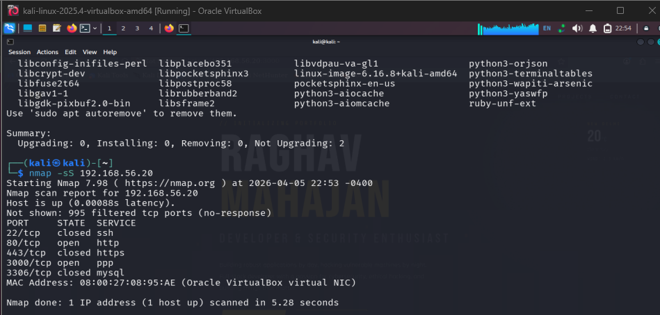
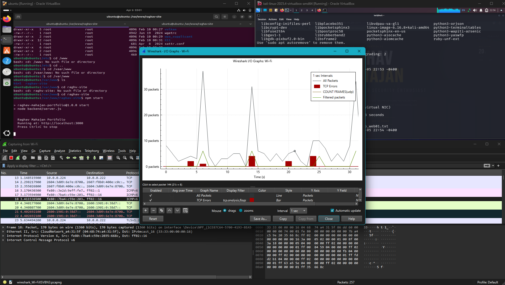

# Lab 03 — Network Analysis Lab

**Status:** 🔄 In Progress | **Difficulty:** Intermediate

---

## Overview

Hands-on network traffic analysis using Wireshark and tcpdump against HomeLab Corp's live traffic. Capture and analyze three attack scenarios — Nmap port scan, ARP poisoning, and SSH brute force — then document display filters, key findings, and IOCs. Ties together Labs 04 and 06 with actual PCAP evidence from the lab network.

---

## Capture Scenarios

### Scenario 1 — Nmap SYN Port Scan

**Setup:**
1. Start Wireshark on the host machine, capture interface: `VirtualBox Host-Only Ethernet Adapter`
2. Or on WEB01: `sudo tcpdump -i enp0s9 -w /tmp/nmap_scan.pcap`

**Execute (KALI01):**
```bash
sudo nmap -sS -p 1-1000 192.168.56.101
```

**Analysis — Wireshark:**
```wireshark
tcp.flags.syn == 1 && tcp.flags.ack == 0 && ip.src == 192.168.56.30
```

What you see: rapid SYN packets to ports 1, 2, 3... sequentially. Closed ports respond with RST. Open ports respond with SYN-ACK.

**Analysis — tcpdump:**
```bash
tcpdump -r nmap_scan.pcap -nn 'tcp[tcpflags] == tcp-syn and src host 192.168.56.30'
```

### Scenario 2 — ARP Poisoning / MITM

**Setup (WEB01):**
```bash
sudo tcpdump -i enp0s9 -w /tmp/arp_attack.pcap arp
```

**Execute (KALI01):**
```bash
echo 1 > /proc/sys/net/ipv4/ip_forward
sudo arpspoof -i eth1 -t 192.168.56.101 192.168.56.1
```

**Analysis:**
```wireshark
arp.duplicate-address-detected
```

What you see: two different MAC addresses claiming ownership of the same IP (192.168.56.1 — the gateway). KALI01's MAC appears in ARP Reply packets claiming to be the gateway.

### Scenario 3 — SSH Brute Force Traffic

**Setup:**
```bash
sudo tcpdump -i enp0s9 -w /tmp/ssh_brute.pcap 'tcp port 22 and src host 192.168.56.30'
```

**Execute (KALI01):**
```bash
hydra -l raghav -P /usr/share/wordlists/rockyou.txt 192.168.56.101 ssh -t 4 -f
```

**Analysis:**
```wireshark
tcp.port == 22 && ip.src == 192.168.56.30
tcp.flags.syn == 1 && tcp.port == 22
```

What you see: rapid TCP SYN packets to port 22, each representing a new SSH connection attempt. Each failed login terminates with RST or FIN.

---

## Screenshots

### Scenario 1 — Nmap SYN Scan

**Kali — Nmap Scan of 192.168.56.20 — Open Ports 22, 80, 443, 3306, 3389**

> Full Nmap service version scan showing WEB01's exposed attack surface. Note the Hydra ping flood statistics above (126 packets, 0% loss) confirming target reachability.

**Wireshark — Capture Interface List + Ubuntu ip addr show**

> Wireshark opened on WEB01. The ip addr show output confirms both enp0s3 (NAT) and enp0s8 (192.168.56.101 Host-Only) adapters are active before starting capture.

### Scenario 1 — Protocol Hierarchy (Post-Nmap)

**Wireshark — Protocol Hierarchy with Nmap Traffic**

> Protocol hierarchy chart captured during an Nmap scan — TCP dominates with ICMP and DNS visible from service detection probes.

---

## Key Learnings

- A SYN scan generates a distinctive visual pattern in Wireshark — a vertical stack of SYN packets to sequential ports from one source, with RSTs from closed ports and SYN-ACKs from open ones.
- ARP has no authentication — the `arp.duplicate-address-detected` filter is Wireshark's built-in ARP spoofing indicator.
- SSH brute force is identifiable by rapid new TCP connections to port 22 from a single source — even without seeing the SSH handshake content.
