# Lab 05 — Ubuntu Server Setup & Web Hosting

**Status:** ✅ Complete | **Date:** March 9, 2026 | **Environment:** homecorp.local

---

## Overview

Set up Ubuntu 22.04 LTS (WEB01) as a vulnerable web server and portfolio host in VirtualBox. Configured dual-adapter networking (NAT + Host-Only), assigned a static IP, deployed a Node.js + Express portfolio application, and made it accessible from every VM on the HomeLab network. This is the primary attack target for all web and brute force labs.

**End State:** Portfolio site live at `http://192.168.56.101:3000`, reachable from KALI01, accessible from host browser via port forwarding, persistent via PM2.

---

## Environment

| Item | Detail |
|------|--------|
| VM Name | WEB01 |
| OS | Ubuntu 22.04 LTS |
| IP | 192.168.56.101 (Host-Only) |
| NAT IP | 10.0.2.15 (internet access) |
| Web Stack | Node.js + Express (port 3000) |
| Secondary | Apache2 + PHP + MySQL (DVWA) |
| Domain | homecorp.local |

### Network Architecture

```
Host PC  ──  vboxnet0 (192.168.56.1)  ──  Host-Only Network
                    |
                    |──  WEB01   Ubuntu         192.168.56.101
                    |──  KALI01  Kali Linux     192.168.56.30
                    |──  DC01    Windows Server 192.168.56.10
```

WEB01 has **two adapters**:
- **Adapter 1 (NAT)** → internet access (apt, npm)
- **Adapter 2 (Host-Only vboxnet0)** → LAN reachable from other VMs

---

## Phase 01 — VM Creation

### VirtualBox Settings

| Setting | Value |
|---------|-------|
| RAM | 4096 MB |
| CPUs | 2 |
| Disk | 30 GB VDI (dynamically allocated) |
| Adapter 1 | NAT |
| Adapter 2 | Host-Only Adapter (vboxnet0) |
| OS | Ubuntu 22.04 LTS Desktop |

**Critical:** Do NOT use the ISO field in the New VM wizard — leave it blank and attach the ISO manually via Settings → Storage afterwards. Using the wizard's ISO field creates a 0B placeholder that breaks installation.

---

## Phase 02 — Ubuntu Installation

Standard install steps:
1. Boot VM → select the Ubuntu ISO
2. Choose **Normal Installation** + **Install third-party software**
3. Installation type: **Erase disk and install Ubuntu** (virtual disk only)
4. Set hostname: `web01`, note username/password in credential register
5. Wait ~15 minutes → reboot

### First Boot — System Update

```bash
sudo apt update && sudo apt upgrade -y
sudo apt install -y build-essential curl wget git unzip net-tools
```

### Guest Additions (skip the CD approach — use apt)

```bash
sudo apt install -y virtualbox-guest-utils virtualbox-guest-x11
sudo reboot
```

---

## Phase 03 — Network Configuration

### Verify Both Interfaces

```bash
ip addr show
# Expected output:
# lo        — 127.0.0.1 (loopback)
# enp0s3    — 10.0.2.15  (NAT, internet)
# enp0s8    — 192.168.56.101  (Host-Only, attack target)
```

If `enp0s8` is missing: shut down VM → Settings → Network → Adapter 2 → Enable → Host-Only Adapter → vboxnet0.

### Set Static IP on Host-Only Interface

```bash
sudo nano /etc/netplan/01-network-manager-all.yaml
```

```yaml
network:
  version: 2
  ethernets:
    enp0s3:
      dhcp4: true
    enp0s8:
      dhcp4: no
      addresses: [192.168.56.101/24]
```

```bash
sudo netplan apply
ip addr show enp0s8    # verify 192.168.56.101 is assigned
```

---

## Phase 04 — Node.js Portfolio Deployment

### Install Node.js

```bash
sudo apt install -y nodejs npm
node --version    # should be v18+
npm --version
```

### Deploy Portfolio Site

```bash
cd /var/www
sudo mkdir raghav-batman
sudo chown -R $USER:$USER /var/www/raghav-batman
cd /var/www/raghav-batman

# Copy project files here, then:
npm install
npm start
```

Site accessible at: `http://192.168.56.101:3000`

### Make Persistent with PM2

Without PM2, the site stops when the terminal closes.

```bash
sudo npm install -g pm2
pm2 start backend/server.js --name portfolio
pm2 save
pm2 startup    # copy the command it outputs and run it
pm2 status     # verify: online
```

---

## Phase 05 — Apache + PHP + MySQL (DVWA Target)

```bash
sudo apt install -y apache2 php libapache2-mod-php php-mysql mysql-server
sudo systemctl enable apache2 mysql
sudo systemctl start apache2 mysql
sudo systemctl status apache2
```

UFW: allow port 80 and 3000:
```bash
sudo ufw allow 80/tcp
sudo ufw allow 3000/tcp
sudo ufw status
```

---

## Phase 06 — ngrok (Optional — Public URL)

```bash
sudo snap install ngrok

# Start tunnel (run alongside pm2)
ngrok http 3000
# Forwarding: https://abc123.ngrok-free.app -> http://localhost:3000
```

Limitation: URL changes every restart. For permanent URL → deploy to Railway.app or Render.com.

---

## Milestones Verified

| Checkpoint | Command | Expected |
|-----------|---------|---------|
| Both adapters | `ip addr show` | enp0s3 + enp0s8 visible |
| Static IP | `ip addr show enp0s8` | 192.168.56.101 |
| Node.js installed | `node --version` | v18+ |
| Site local | `curl http://localhost:3000` | HTML response |
| Site on network | `curl http://192.168.56.101:3000` | HTML response from KALI01 |
| PM2 running | `pm2 status` | portfolio: online |
| Apache running | `sudo systemctl status apache2` | active (running) |

---

## Troubleshooting

| Problem | Cause | Fix |
|---------|-------|-----|
| 0B ISO placeholder in Storage | VirtualBox unattended install wizard | Attach ISO manually via Storage settings |
| `VERR_PDM_MEDIA_LOCKED` | Optical drive locked by placeholder | Remove placeholder → install via apt instead |
| No 192.168.56.x IP | Adapter 2 not enabled | Shut down → enable Adapter 2 → vboxnet0 → start |
| Port 3000 not reachable from Kali | UFW blocking or wrong IP | `sudo ufw allow 3000/tcp` + verify static IP |
| `EADDRINUSE: port 3000` | Previous server instance running | `sudo lsof -i :3000` → `sudo kill -9 <PID>` |
| Weather widget offline | No internet from NAT adapter | Check NAT adapter → `curl https://google.com` |
| VirtualBox menu bar hidden | Fullscreen mode | Right Ctrl + F to toggle fullscreen off |

---

## Screenshots

### VM Setup

**VirtualBox Storage — 0B Placeholder ISO (The Bug)**
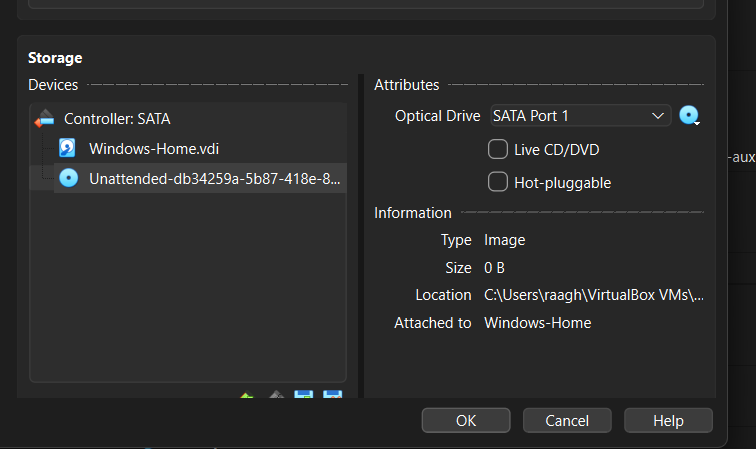
> The unattended installer created a 0B fake ISO. Fix: attach the real Ubuntu ISO manually via the CD icon.

**Network Adapter 1 = NAT Network (SOC-HomeLab)**
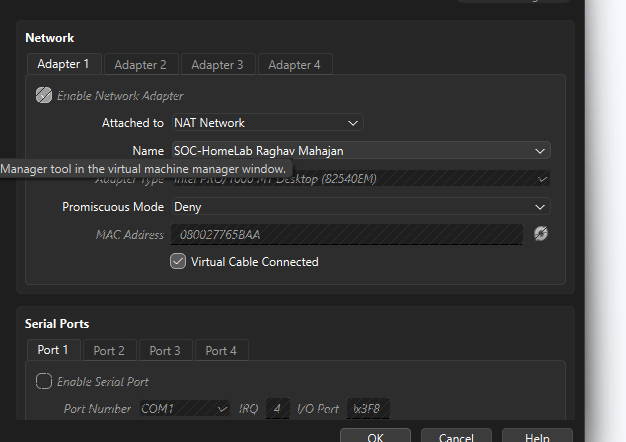
> Adapter 1 provides internet access for apt/npm installs.

---

### Network Configuration

**ip addr show — All Interfaces Visible**
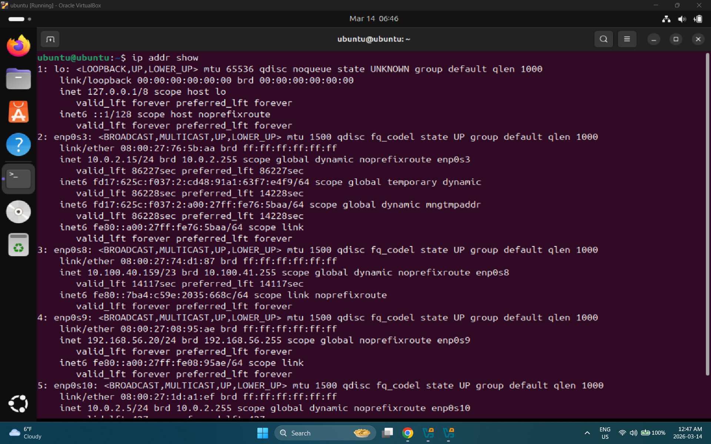
> Shows all adapters including the Host-Only (192.168.56.x) interface confirming both adapters are up.

**ip addr show enp0s8 — Host-Only Interface**
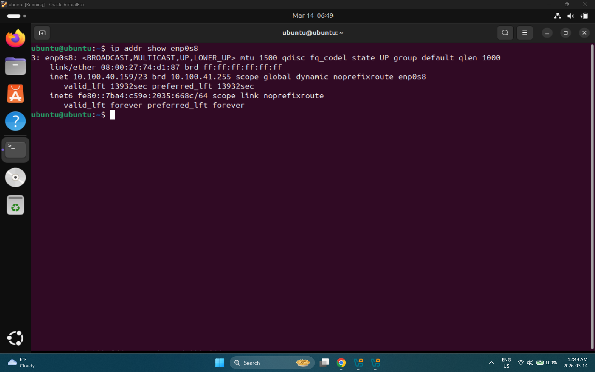

---

### System Update & Software Install

**sudo apt update && apt upgrade Running**
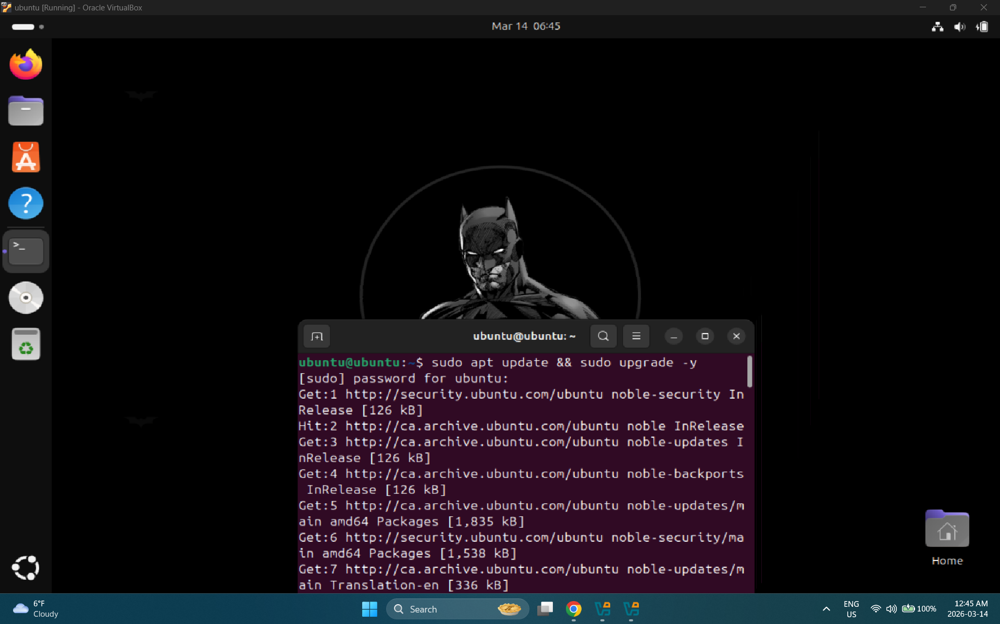

**Kali Linux — apt upgrade (Attack VM Also Updated)**
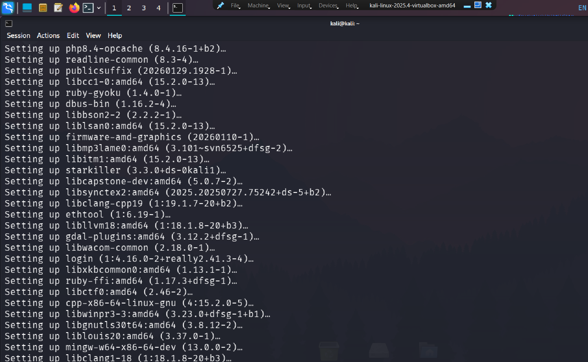
> Kali updated in parallel, installing php8.4, ruby, libcapstone and all attack tools.

**Node.js v18.19.1 and npm 9.2.0 Confirmed**
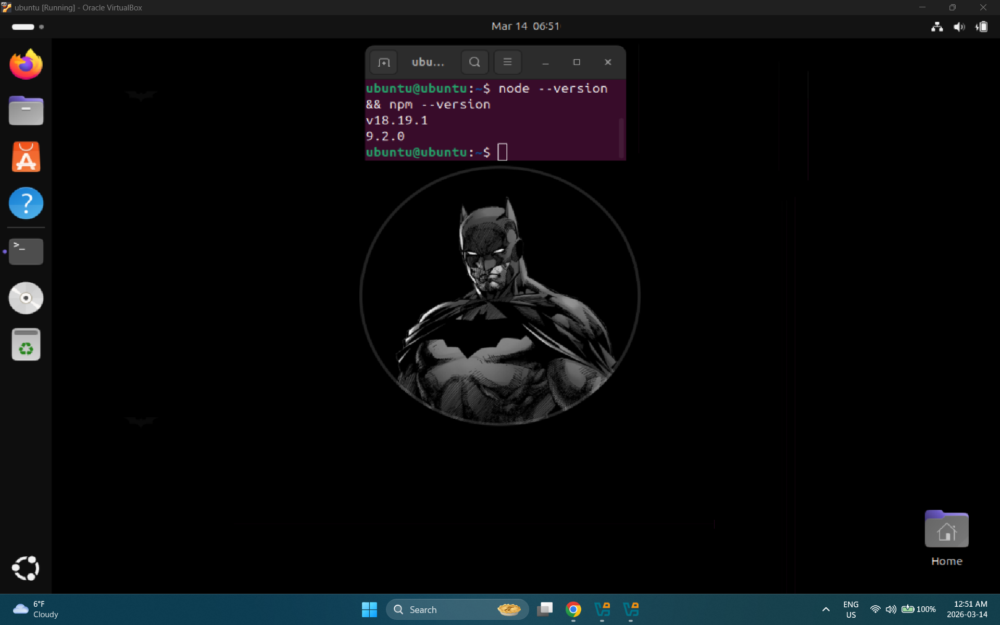

**Apache2 Status — Active (Running)**
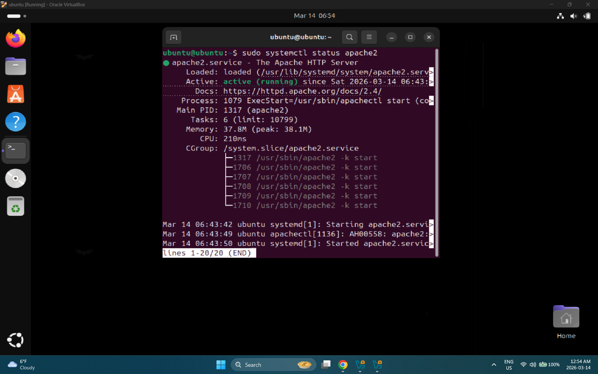

**Apache Config + ss -tlnp Port 3000 + UFW Allow 3000**
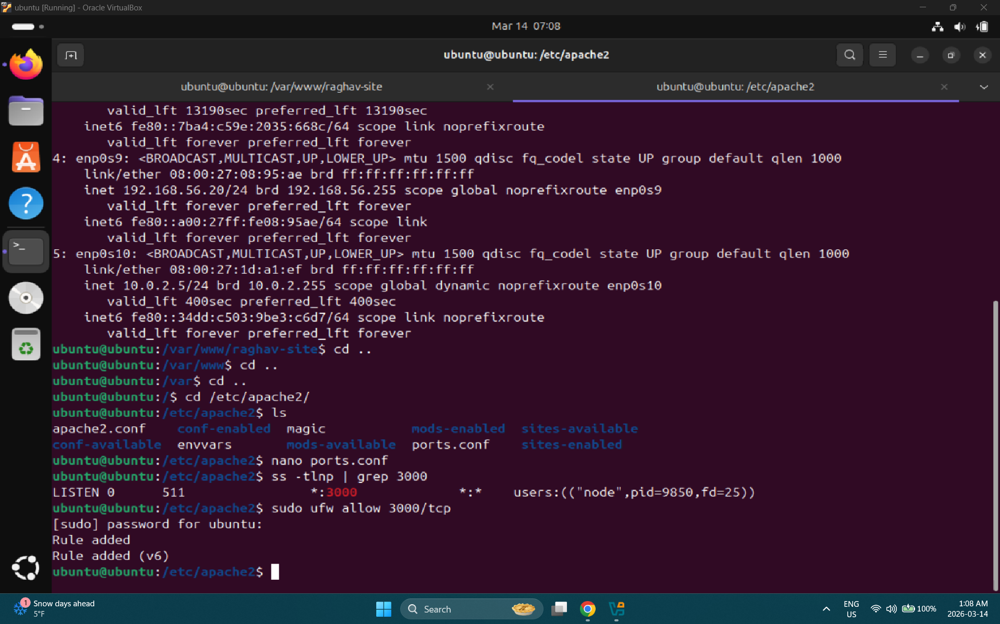

---

### Portfolio Website Deployment

**npm start — Server Running at localhost:3000**
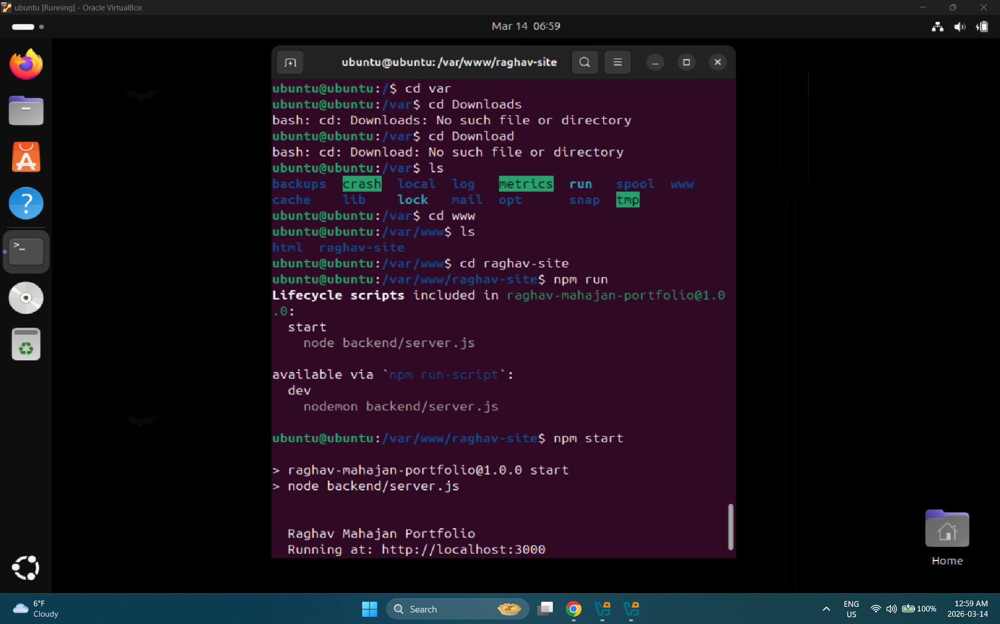

**PM2 Status — portfolio: online (Persistent)**
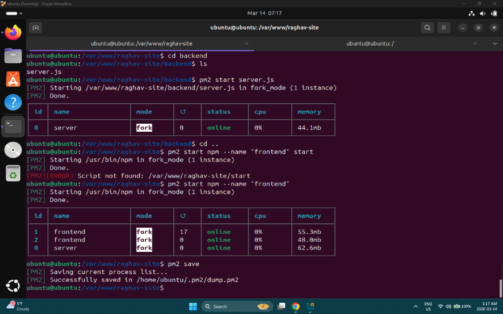
> frontend (2 instances) + server process all online with 0% CPU.

---

### Website Live on Network

**Site Live in Host Browser — 192.168.56.101:3000**
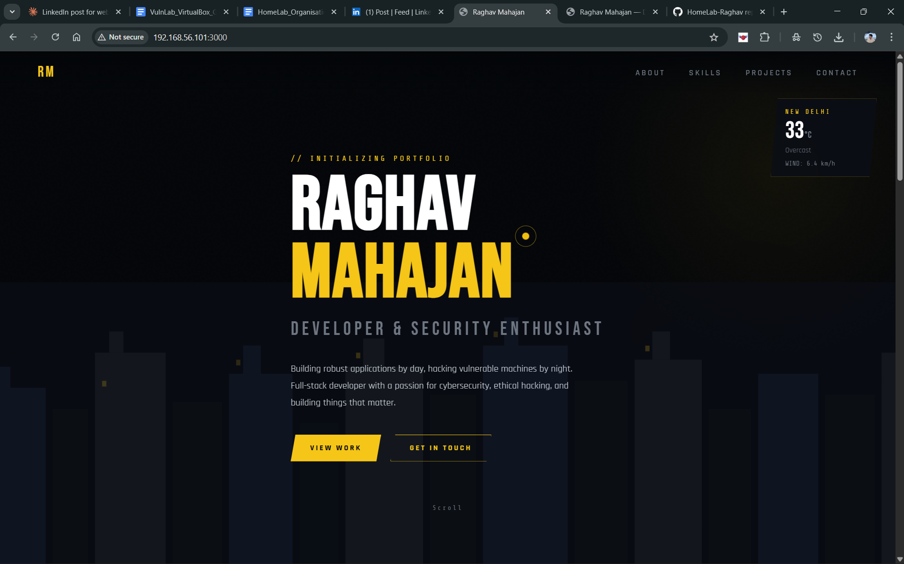
> Batman theme portfolio fully rendered — weather widget showing New Delhi 33°C.

**Site Accessed from Kali Linux Browser**
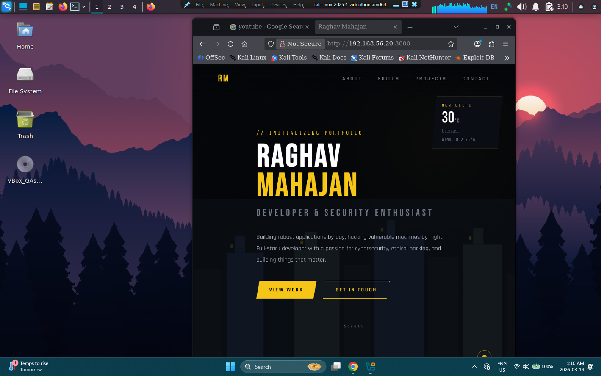
> Confirms 192.168.56.x network is working — Kali can reach WEB01.

**Site at Direct URL (Clean Address Bar)**
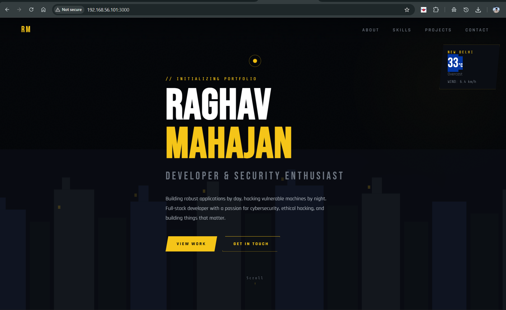

**About Section — WHO IS RAGHAV**
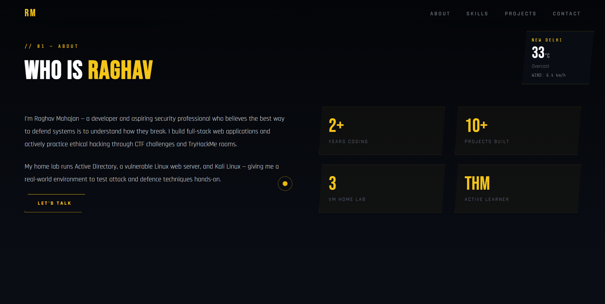
> Stats cards: 2+ years coding, 10+ projects built, 3 VM Home Lab, THM Active Learner.

---

### ngrok Public Tunnel

**ngrok Tunnel Active — Public URL Generated**
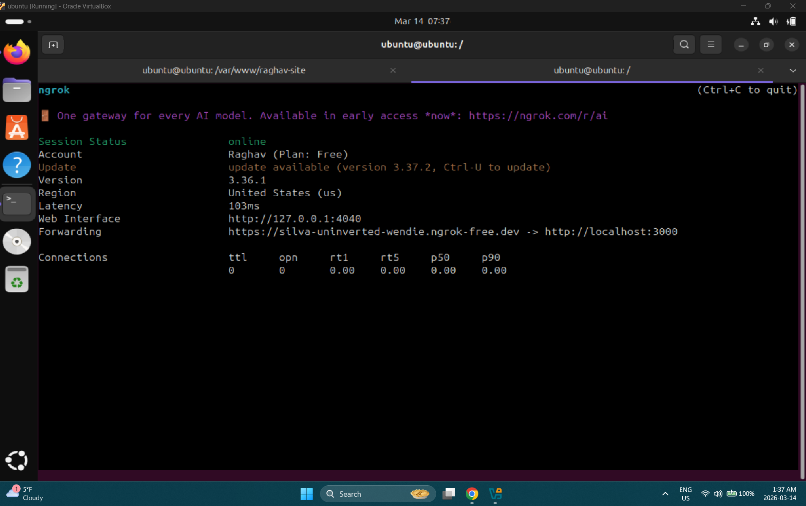
> `https://silva-uninverted-wendle.ngrok-free.dev -> http://localhost:3000`

**Ubuntu — File Listing + npm + Portfolio Live**
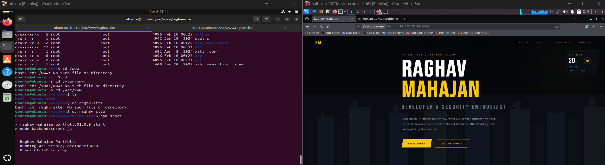
> Ubuntu terminal showing project file listing, npm start output, and portfolio running. Confirms Node.js app fully deployed on WEB01.

---

## Next Attack Surface

WEB01 is now the primary target for:
- **Nmap scan:** `nmap -sV -p- 192.168.56.101` (Labs 02, 03)
- **Web recon:** `nikto -h http://192.168.56.101:3000`
- **Directory brute:** `gobuster dir -u http://192.168.56.101:3000 -w /usr/share/wordlists/dirb/common.txt`
- **SSH brute force:** `hydra -l raghav -P rockyou.txt 192.168.56.101 ssh` (Lab 08)
- **FIM monitoring:** Wazuh watches `/var/www/html` in realtime (Lab 07)

## Key Learnings

- Two network adapters are required — NAT for internet (apt/npm), Host-Only for lab connectivity. Without Adapter 2, no other VM can reach the web server.
- Static IP via Netplan is mandatory — DHCP will assign different addresses across reboots, breaking any saved URLs or firewall rules.
- PM2 is the production-grade solution for keeping Node.js apps alive — it survives reboots and auto-restarts on crash.
- The web server at `192.168.56.101` is the first permanent attack surface in the HomeLab — once it's live, every subsequent lab can target it.
