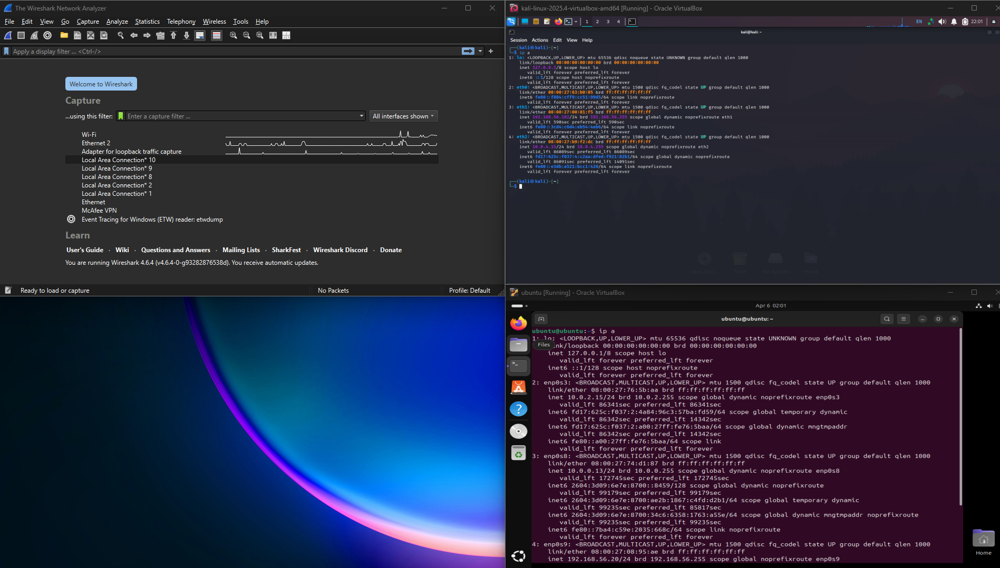
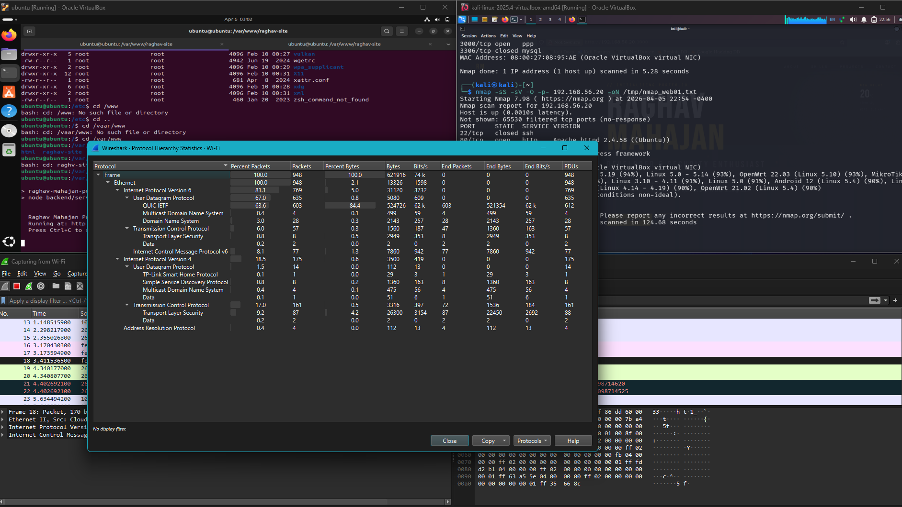
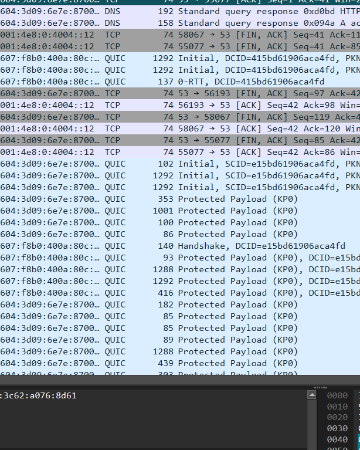
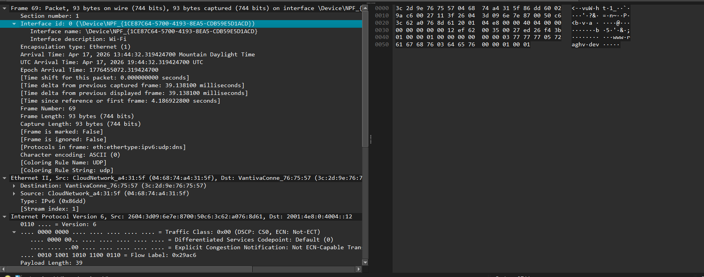
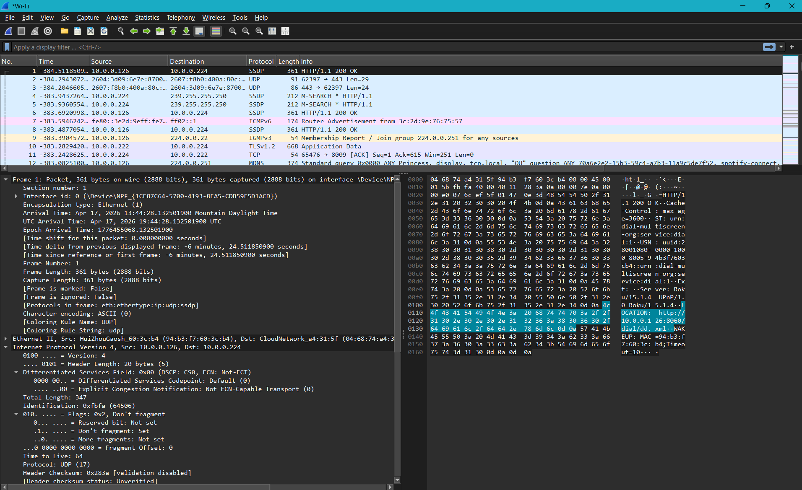

# Lab 06 — Wireshark Packet Analysis

**Status:** ✅ Complete | **Date:** April 2026 | **Series:** Security+ Prep & HomeLab

---

## Overview

Complete Wireshark reference covering packet capture fundamentals, the OSI model in practice, hex/binary reading, all protocols encountered in HomeLab Corp traffic, display filter mastery, and attack detection scenarios. Built as a companion to the IR Cycle Simulation lab — the skills here are used to validate every Wazuh alert by examining the raw packet evidence.

---

## The Three Panels

| Panel | Location | What It Shows |
|-------|----------|---------------|
| Packet List | Top | One row per packet — time, src, dst, protocol, summary |
| Packet Details | Middle | Expandable protocol layer tree — this is where you read data |
| Packet Bytes | Bottom | Raw hex on left, ASCII on right |

**Capture vs Display Filters:**

| Type | When Applied | Syntax | Example |
|------|-------------|--------|---------|
| Capture Filter | BEFORE capture — limits what gets saved | BPF | `tcp port 80` |
| Display Filter | AFTER capture — hides/shows already captured | Wireshark language | `tcp.flags.syn == 1` |

---

## OSI Model in Wireshark

Each expandable section in the Packet Details panel is one OSI layer:

| Layer | Name | Role | Examples |
|-------|------|------|---------|
| 7 | Application | Actual app data | HTTP, DNS, SMTP, SSH, RDP |
| 6 | Presentation | Encoding, encryption | TLS/SSL, JPEG, ASCII |
| 5 | Session | Managing connections | NetBIOS, RPC, SOCKS |
| 4 | Transport | Reliable delivery, ports | TCP, UDP, SCTP |
| 3 | Network | Logical addressing | IPv4, IPv6, ICMP, ARP |
| 2 | Data Link | Physical addressing | Ethernet, Wi-Fi |
| 1 | Physical | Raw bits | Frame metadata |

### Reading a Full Packet (HTTP Example)

```
Frame 42: 200 bytes — interface eth1
  Ethernet II
    Dst: aa:bb:cc:dd:ee:ff  Src: 11:22:33:44:55:66  Type: IPv4 (0x0800)
      Internet Protocol Version 4
        Src: 192.168.56.102 (KALI01)  Dst: 192.168.56.101 (WEB01)  TTL: 64  Proto: TCP
          Transmission Control Protocol
            Src Port: 54231  Dst Port: 80  Flags: SYN
              Hypertext Transfer Protocol
                GET /index.html HTTP/1.1
                Host: 192.168.56.101
```

---

## Reading Hex

```
Offset  Hex                                               ASCII
0000    45 00 00 3c 1a 46 40 00 40 06 9c 2c c0 a8 38 66  E..<.F@.@..,..8f
0010    47 45 54 20 2f 69 6e 64 65 78 2e 68 74 6d 6c 20  GET /index.html
```

**IPv4 Header Hex Breakdown:**

| Bytes (Hex) | Field | Value | Explanation |
|-------------|-------|-------|-------------|
| `45` | Version + IHL | IPv4, 20-byte header | 4=IPv4, 5×4=20 bytes |
| `00 3c` | Total Length | 60 bytes | Full packet size |
| `40` | TTL | 64 hops | Linux default TTL |
| `06` | Protocol | TCP | 6=TCP, 17=UDP, 1=ICMP |
| `c0 a8 38 66` | Source IP | 192.168.56.102 | c0=192, a8=168, 38=56, 66=102 |

**TTL OS Fingerprinting:**
- TTL ≈ 64 → Linux / macOS / Android
- TTL ≈ 128 → Windows
- TTL ≈ 255 → Cisco / network devices

**Common Hex Values:**

| Hex | Decimal | Meaning |
|-----|---------|---------|
| `0x0800` | 2048 | IPv4 — EtherType |
| `0x0806` | 2054 | ARP — EtherType |
| `0x06` | 6 | TCP — IP Protocol |
| `0x11` | 17 | UDP — IP Protocol |
| `0x50` | 80 | Port 80 — HTTP |
| `0x01BB` | 443 | Port 443 — HTTPS |
| `0x0016` | 22 | Port 22 — SSH |

---

## Display Filters Reference

### Essential Filters by Scenario

```wireshark
# Catch Nmap SYN port scan
tcp.flags.syn == 1 && tcp.flags.ack == 0

# See closed ports (RST responses from scan)
tcp.flags.reset == 1

# Show all cleartext web traffic
http

# Find failed web auth attempts
http.response.code == 401

# See what HTTPS sites visited (via SNI — no decryption needed)
tls.handshake.extensions_server_name

# Find large data transfers (possible exfil)
frame.len > 1400

# Exclude noisy background traffic
!(arp || ssdp || mdns || icmpv6)

# Show only DNS queries (not responses)
dns && dns.flags.response == 0

# Find DNS exfiltration (abnormally long query names)
dns.qry.name.len > 50

# Catch ARP spoofing
arp.duplicate-address-detected

# Find SSH brute force attempts
tcp.port == 22 && tcp.flags == 0x002

# Show Kerberos auth attempts
kerberos.msg_type == 10

# Find SMB file access
smb2.cmd == 0x0005

# Find retransmissions (packet loss indicator)
tcp.analysis.retransmission

# Find large ICMP (possible ICMP tunnel)
icmp && frame.len > 100

# Show all traffic between KALI01 and WEB01
ip.addr == 192.168.56.30 && ip.addr == 192.168.56.101
```

### Filter Syntax Operators

| Operator | Symbol | Example |
|----------|--------|---------|
| Equal | `==` | `ip.src == 192.168.56.30` |
| Not Equal | `!=` | `tcp.port != 80` |
| Greater Than | `>` | `frame.len > 1000` |
| AND | `&&` | `ip.src == 1.1.1.1 && tcp` |
| OR | `\|\|` | `tcp.port == 80 \|\| tcp.port == 443` |
| NOT | `!` | `!arp` |
| Contains | `contains` | `http contains "password"` |
| Regex | `matches` | `dns.qry.name matches ".*google.*"` |

---

## Protocol Reference

### TCP — 3-Way Handshake

```
Step 1: Client → Server    SYN        Seq=0
Step 2: Server → Client    SYN, ACK   Seq=0, ACK=1
Step 3: Client → Server    ACK        Seq=1, ACK=1
```

**TCP Flags:**

| Flag | Meaning | SOC Relevance |
|------|---------|---------------|
| SYN | Start connection | SYN-only flood = port scan |
| ACK | Acknowledge | Normal in every packet after handshake |
| FIN | Graceful close | Normal teardown |
| RST | Hard reset | Closed port, firewall block |
| PSH | Push data immediately | Data transfer |

### Kerberos — Active Directory Auth

| Message | What Happens |
|---------|-------------|
| AS-REQ | Client asks DC for TGT |
| AS-REP | DC sends back TGT (encrypted with user's password hash) |
| TGS-REQ | Client requests service ticket |
| TGS-REP | DC sends service ticket |

**Kerberos Attacks to Detect:**
- **Kerberoasting:** `kerberos.msg_type == 30` from unusual sources
- **AS-REP Roasting:** AS-REP without prior AS-REQ (no preauthentication)
- **Pass the Ticket:** Kerberos auth from unexpected IP for a known account

### TLS — Reading SNI Without Decryption

In the Client Hello packet, expand:
`TLS → Handshake Protocol → Extension: server_name → Server Name`

The SNI reveals the domain being connected to — even in encrypted HTTPS. This is how you identify malware C2 domains without decrypting TLS.

---

## Attack Detection Scenarios

### Scenario 1 — Nmap SYN Port Scan

```
Filter: tcp.flags.syn == 1 && tcp.flags.ack == 0
```
You'll see rapid SYN packets to sequential port numbers from one source. Closed ports respond with RST. The scan generates a distinctive fan pattern in the Conversations view.

### Scenario 2 — ARP Poisoning / MITM

```
Filter: arp.duplicate-address-detected
```
Look for two different MAC addresses claiming the same IP. The attacker's MAC will appear in ARP replies claiming ownership of the gateway IP, redirecting all victim traffic.

### Scenario 3 — Cleartext Credential Capture

```
Filter: http && http.request.method == "POST"
Right-click → Follow → HTTP Stream
```
The full request body appears in red (client). Credentials submitted to login forms are plaintext in HTTP traffic.

### Scenario 4 — DNS Exfiltration

```
Filter: dns.qry.name.len > 50
```
Data encoded in DNS query subdomains (e.g., `base64encodeddata.c2domain.com`). High entropy, long query names, many queries to the same unusual external domain.

---

## Keyboard Shortcuts

| Shortcut | Action |
|----------|--------|
| `Ctrl + /` | Focus display filter bar |
| `Ctrl + E` | Start/stop capture |
| `Ctrl + S` | Save capture |
| `Ctrl + F` | Find packet (string or hex) |
| Right-click → Follow → TCP Stream | Reassemble full conversation as text |
| Right-click → Apply as Filter | Auto-build filter from any field value |
| Statistics → Protocol Hierarchy | Protocol breakdown of entire capture |
| Statistics → Conversations | All connections with byte counts |
| Analyze → Expert Information | Auto-flagged errors, warnings, notes |

---

## Lab Scenarios for HomeLab Corp

1. **Nmap SYN Scan:** Start Wireshark on vboxnet0 interface, run `nmap -sS 192.168.56.101` from KALI01, filter `tcp.flags.syn == 1 && tcp.flags.ack == 0`.
2. **ARP Poisoning:** Run `arpspoof -i eth1 -t 192.168.56.101 192.168.56.1` from KALI01, capture on Ethernet 2, filter `arp`.
3. **Cleartext Credential Capture:** Telnet to Metasploitable2, log in, follow the TCP stream — credentials appear in plaintext.

---

## Screenshots

### Opening Wireshark — Interface Selection

**Wireshark — Capture Interface List + Ubuntu ip addr show**

> Wireshark interface list on WEB01. Ubuntu terminal confirms enp0s8 at 192.168.56.101 before selecting the correct capture adapter.

### Protocol Hierarchy Analysis

**Wireshark — Protocol Hierarchy Chart (During Nmap Scan)**

> Protocol hierarchy captured during an Nmap SYN scan from KALI01. Shows TCP dominant with ICMP echoes from Nmap's host discovery phase.

**Wireshark — Protocol Hierarchy Statistics Table**

> Statistics → Protocol Hierarchy detailed breakdown — percent of packets per protocol layer. Used to quickly identify dominant traffic types in a capture.

### Live Packet Capture — DNS + QUIC + TCP

**Wireshark — Packet List: DNS, QUIC, TCP Traffic on Wi-Fi**

> Live capture showing mixed real-world traffic: DNS queries, QUIC (HTTP/3), and TCP streams. Confirms Wireshark works on multiple interface types.

**Wireshark — Packet Details: Frame 69, IPv6 + UDP + DNS**

> Expanded packet details for Frame 69 — shows the full protocol stack: Ethernet II → IPv6 → UDP → DNS. The IPv6 src/dst addresses and DNS query name are visible in the Details panel.

### Full Three-Panel View — HTTP/SSTP with Hex

**Wireshark — Three-Panel View: Packet List + Details + Hex (HTTP Traffic)**

> Classic Wireshark three-panel layout: packet list (top), protocol details (middle), raw hex + ASCII (bottom). HTTP/SSTP traffic selected — the hex panel shows the raw bytes with the ASCII representation confirming cleartext data.

---

## Key Learnings

- The SNI in TLS Client Hello reveals HTTPS destinations without decryption — critical for C2 detection in a SOC environment.
- ARP has zero authentication — anyone can poison the ARP cache and become a MITM. `arp.duplicate-address-detected` is an immediate alert trigger.
- Capture filters (BPF) are limited but save disk space. Display filters are used 90% of the time for analysis.
- TTL values fingerprint the OS of packet senders — TTL 64 = Linux, TTL 128 = Windows.
- HTTP Basic Auth, FTP, and Telnet send credentials in plaintext — visible in the ASCII column of any packet capture.
