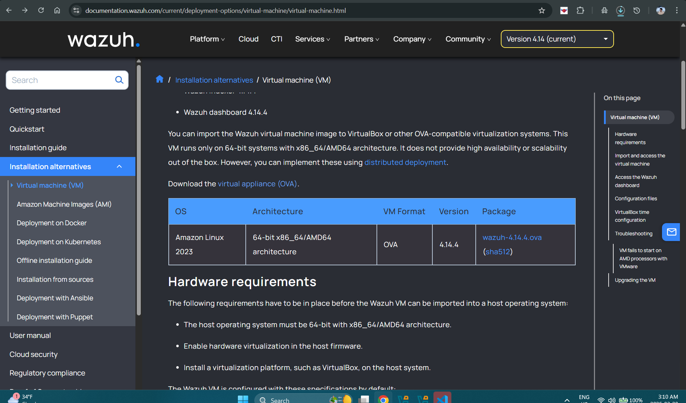
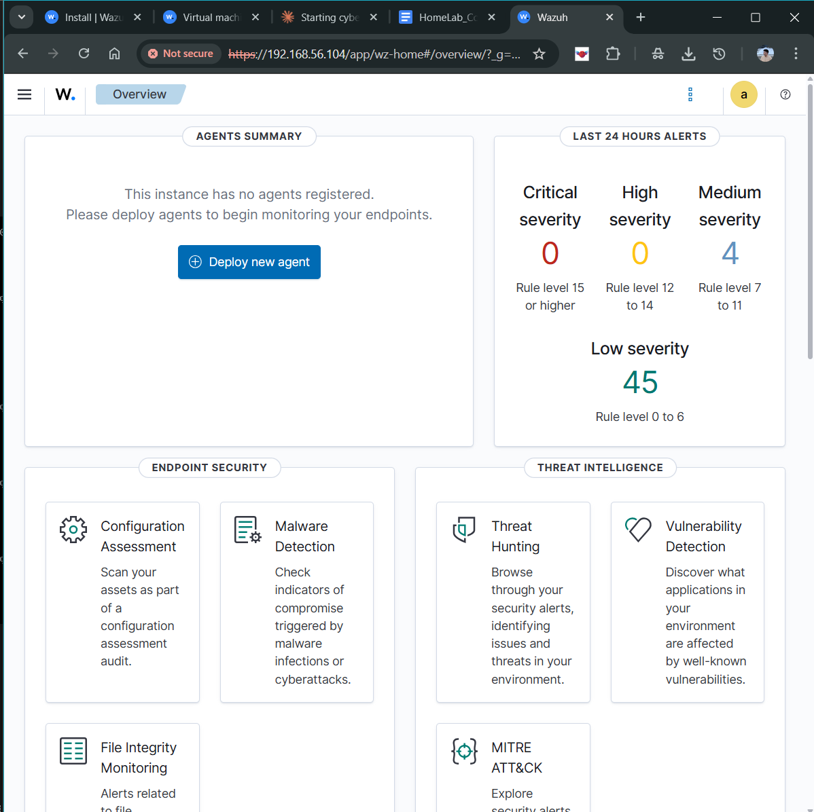
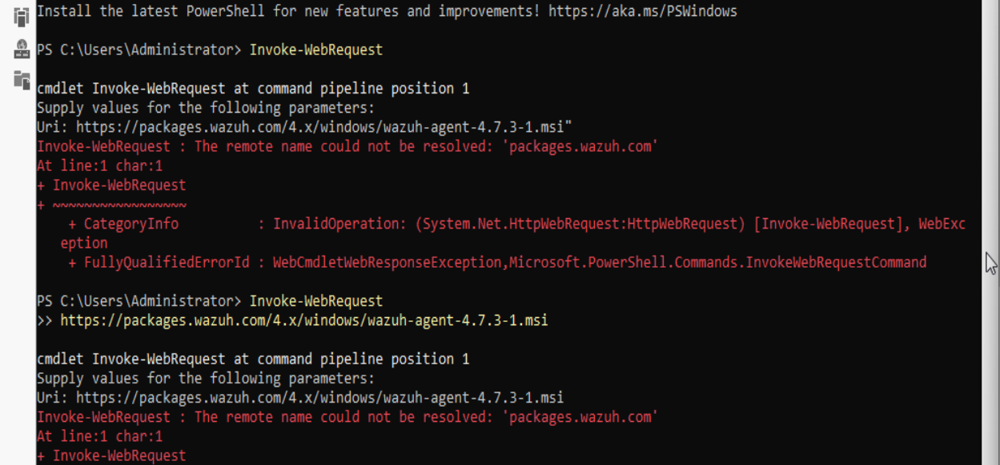
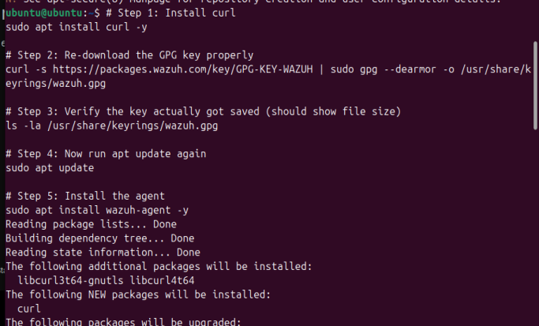
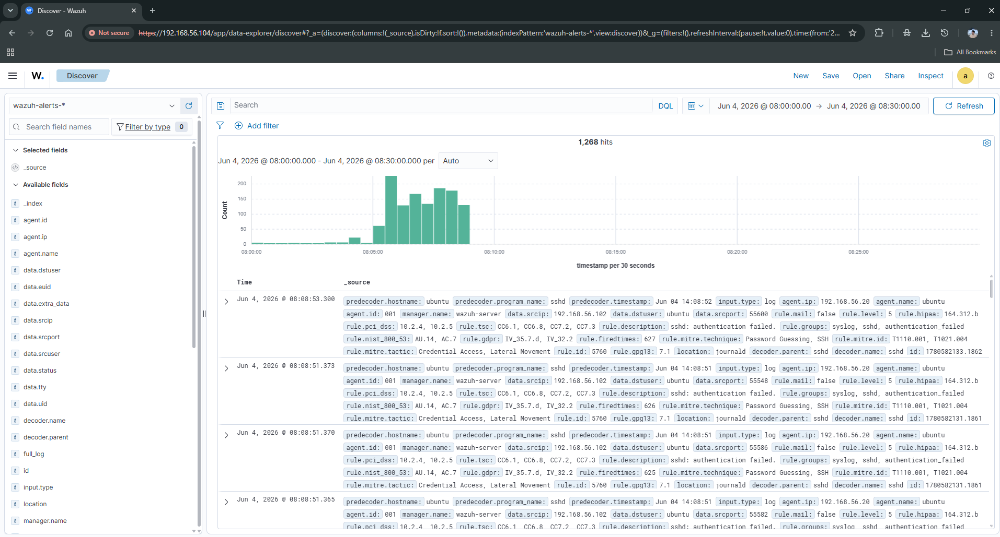

# Lab 07 — Wazuh SIEM Setup

**Status:** ✅ Complete | **Date:** March 2026 | **Environment:** homecorp.local

---

## Overview

Deployed a fully operational Wazuh SIEM (v4.x) across HomeLab Corp's three-node environment. Configured the Wazuh Manager, Indexer (OpenSearch), and Dashboard on WEB01. Deployed agents to DC01 (Windows Server 2022) and WEB01 (Ubuntu, self-monitoring). Configured Active Directory event channels, Apache web log monitoring, File Integrity Monitoring, and validated detection with live attack simulations.

**End State:** Every login, AD change, web request, and file modification in `homecorp.local` is captured, indexed, and queryable in real time from a single dashboard.

---

## Environment

| Node | Role | IP | OS |
|------|------|----|----|
| DC01 | Domain Controller + Wazuh Agent | 192.168.56.10 | Windows Server 2022 |
| WEB01 | Wazuh Manager + Apache + Agent | 192.168.56.101 | Ubuntu Server 22.04 |
| KALI01 | Red Team / Attack Simulation | 192.168.56.30 | Kali Linux |

---

## Phase 01 — Wazuh Manager Deployment (WEB01)

```bash
# System preparation
sudo apt-get update && sudo apt-get upgrade -y
sudo apt-get install curl apt-transport-https unzip wget libcap2-bin -y

# Add Wazuh GPG key and repository
curl -s https://packages.wazuh.com/key/GPG-KEY-WAZUH \
  | sudo gpg --no-default-keyring \
  --keyring gnupg-ring:/usr/share/keyrings/wazuh.gpg \
  --import
sudo chmod 644 /usr/share/keyrings/wazuh.gpg

echo "deb [signed-by=/usr/share/keyrings/wazuh.gpg] \
https://packages.wazuh.com/4.x/apt/ stable main" \
  | sudo tee /etc/apt/sources.list.d/wazuh.list
sudo apt-get update

# Install Wazuh Manager
sudo apt-get install wazuh-manager -y
sudo systemctl daemon-reload
sudo systemctl enable wazuh-manager
sudo systemctl start wazuh-manager
```

**Verify:** `sudo systemctl status wazuh-manager` → `Active: active (running)`

```bash
# Install Wazuh Indexer (OpenSearch)
sudo apt-get install wazuh-indexer -y
sudo /usr/share/wazuh-indexer/bin/indexer-security-init.sh
sudo systemctl enable wazuh-indexer && sudo systemctl start wazuh-indexer

# Verify Indexer health
curl -k -u admin:admin https://localhost:9200
# Expected: JSON with status "green" or "yellow"

# Install Wazuh Dashboard
sudo apt-get install wazuh-dashboard -y
sudo systemctl enable wazuh-dashboard && sudo systemctl start wazuh-dashboard
```

**Dashboard URL:** `https://192.168.56.101` | Default: `admin / admin`

> Change default password immediately after first login: Dashboard → Top-right → Security → Internal Users → admin → Edit

---

## Phase 02 — Wazuh Agent — DC01 (Windows)

```powershell
# Download agent installer (run as Administrator on DC01)
Invoke-WebRequest `
  -Uri "https://packages.wazuh.com/4.x/windows/wazuh-agent-4.7.3-1.msi" `
  -OutFile "C:\wazuh-agent.msi"

# Silent install — point to WEB01 (Wazuh Manager)
msiexec.exe /i C:\wazuh-agent.msi /q `
  WAZUH_MANAGER="192.168.56.101" `
  WAZUH_AGENT_NAME="DC01" `
  WAZUH_REGISTRATION_SERVER="192.168.56.101"

# Start service
NET START WazuhSvc
Get-Service WazuhSvc
```

### Configure Active Directory Event Channels

Edit `C:\Program Files (x86)\ossec-agent\ossec.conf` as Administrator:

```xml
<!-- Security Event Log — Logons, Account Changes -->
<localfile>
  <location>Security</location>
  <log_format>eventchannel</log_format>
</localfile>

<!-- Sysmon — Deep process + network telemetry -->
<localfile>
  <location>Microsoft-Windows-Sysmon/Operational</location>
  <log_format>eventchannel</log_format>
</localfile>

<!-- Directory Service — AD replication, LDAP operations -->
<localfile>
  <location>Directory Service</location>
  <log_format>eventchannel</log_format>
</localfile>

<!-- DNS Server logs -->
<localfile>
  <location>DNS Server</location>
  <log_format>eventchannel</log_format>
</localfile>
```

```powershell
Restart-Service WazuhSvc
```

### Key AD Event IDs Monitored

| Event ID | Meaning | Threat Signal |
|----------|---------|---------------|
| 4624 | Successful logon | Baseline |
| 4625 | Failed logon | Brute Force |
| 4720 | User account created | Persistence |
| 4728 | Added to security group | Privilege Escalation |
| 4769 | Service ticket request | Kerberoasting |
| 4771 | Kerberos pre-auth failure | AS-REP Roasting |
| 4946 | Firewall rule added | Defense Evasion |

---

## Phase 03 — Wazuh Agent — WEB01 (Ubuntu, self-monitoring)

```bash
# WEB01 repo already added — install agent
sudo apt-get install wazuh-agent -y

# Configure agent to point to local Manager
sudo nano /var/ossec/etc/ossec.conf
```

Set the `<client>` block:
```xml
<client>
  <server>
    <address>127.0.0.1</address>
    <port>1514</port>
    <protocol>tcp</protocol>
  </server>
</client>
```

```bash
sudo systemctl enable wazuh-agent && sudo systemctl start wazuh-agent

# Verify connection
sudo tail -f /var/ossec/logs/ossec.log | grep "Connected"
# Expected: Connected to the server (127.0.0.1:1514)
```

---

## Phase 04 — Apache Web Server Monitoring

```bash
# Install Apache
sudo apt-get install apache2 -y
sudo systemctl enable apache2 && sudo systemctl start apache2
```

Add to `/var/ossec/etc/ossec.conf`:

```xml
<!-- Apache Access + Error Log monitoring -->
<localfile>
  <location>/var/log/apache2/access.log</location>
  <log_format>apache</log_format>
</localfile>

<localfile>
  <location>/var/log/apache2/error.log</location>
  <log_format>apache</log_format>
</localfile>

<!-- File Integrity Monitoring on web root -->
<syscheck>
  <frequency>300</frequency>
  <directories check_all="yes" realtime="yes" report_changes="yes">
    /var/www/html
  </directories>
  <directories check_all="yes" realtime="yes">
    /etc/apache2
  </directories>
</syscheck>
```

```bash
sudo systemctl restart wazuh-manager
```

### Generate Test Web Traffic

```bash
# From KALI01 or any host
curl http://192.168.56.101/
curl http://192.168.56.101/admin          # 404 — recon signal
curl http://192.168.56.101/.env           # config exposure probe
curl http://192.168.56.101/shell.php      # webshell access attempt
curl "http://192.168.56.101/../../../../etc/passwd"  # directory traversal
curl "http://192.168.56.101/index.php?id=1'+OR+'1'='1"  # SQLi probe
```

Expected alerts: Rule 31101 (400 error), Rule 31151 (forbidden path), Rule 31106 (XSS attempt)

---

## Phase 05 — Validation Testing

### Trigger AD Alerts (DC01)

```powershell
# Brute force simulation — 5 failed logons (Event ID 4625)
1..5 | ForEach-Object {
  $cred = New-Object System.Management.Automation.PSCredential(
    "homecorp\FakeUser",
    (ConvertTo-SecureString "WrongPassword123" -AsPlainText -Force)
  )
  Start-Process cmd -Credential $cred -ErrorAction SilentlyContinue
}

# Create + delete test user (Event IDs 4720 + 4726)
New-ADUser -Name "TestSOCUser" -AccountPassword (ConvertTo-SecureString "P@ssw0rd!" -AsPlainText -Force) -Enabled $true
Remove-ADUser -Identity "TestSOCUser" -Confirm:$false

# Add user to Domain Admins (Event ID 4728) — remove immediately
Add-ADGroupMember -Identity "Domain Admins" -Members "testuser01"
Remove-ADGroupMember -Identity "Domain Admins" -Members "testuser01" -Confirm:$false
```

### Trigger Linux/SSH Alerts (from KALI01)

```bash
# Failed SSH logon
ssh fakeuser@192.168.56.101

# Rapid SSH failures — brute force detection
for i in {1..10}; do ssh fakeuser@192.168.56.101 2>/dev/null; done

# Nmap scan
nmap -sV -p 22,80,443,9200 192.168.56.101

# Simulated webshell drop (FIM alert)
sudo touch /var/www/html/evil-shell.php
# Wazuh alerts within seconds via realtime FIM
sudo rm /var/www/html/evil-shell.php
```

### Wazuh Dashboard Query Reference

```
# Failed logons across all agents
rule.groups: "authentication_failed"

# DC01 events only
agent.name: "DC01"

# High severity alerts
rule.level: [10 TO 15]

# Specific Windows Event ID
data.win.system.eventID: "4625"

# File integrity alerts
rule.groups: "syscheck"

# Apache 4xx errors
rule.id: [31101 TO 31199]
```

---

## Troubleshooting

| Failure | Cause | Fix |
|---------|-------|-----|
| Agent shows Disconnected | Service not running or wrong Manager IP | `Get-Service WazuhSvc` / check ossec.conf `<address>` |
| Dashboard not loading | Indexer down | `sudo systemctl restart wazuh-indexer && wazuh-dashboard` |
| No alerts appearing | Agent not registered or log format wrong | `sudo /var/ossec/bin/agent_control -l` |
| FIM not alerting | inotify limit too low | `echo "fs.inotify.max_user_watches=524288" >> /etc/sysctl.conf && sudo sysctl -p` |
| Indexer crashes | Insufficient RAM | Edit `/etc/wazuh-indexer/jvm.options` → set `-Xms1g -Xmx1g` |

---

## Port Reference

| Port | Service |
|------|---------|
| TCP 443 | Wazuh Dashboard |
| TCP 9200 | Wazuh Indexer (OpenSearch) |
| TCP 55000 | Wazuh Manager API |
| TCP 1514 | Agent log forwarding |
| TCP 1515 | Agent registration |
| TCP 80 | Apache HTTP |

---

## Custom Rules (Pro Tip)

```xml
<!-- /var/ossec/etc/rules/local_rules.xml -->
<!-- Alert on DC01 logon outside business hours -->
<rule id="100001" level="12">
  <if_sid>60106</if_sid>
  <time>18:00 - 08:00</time>
  <description>DC01 logon outside business hours</description>
</rule>
```

```bash
sudo systemctl restart wazuh-manager
```

---

## Screenshots

### Phase 1 — Wazuh Manager Deployment

**Wazuh — Official VM Download Page**

> Wazuh documentation page showing the OVA appliance download option — the fastest way to deploy the full Wazuh stack (Manager + Indexer + Dashboard) in VirtualBox.

### Phase 2 — First Dashboard Login

**Wazuh Dashboard — No Agents Registered (Initial State)**

> Wazuh Dashboard overview immediately after deployment. 0 agents connected, but 45 Low severity alerts already generated by Wazuh's own internal monitoring.

### Phase 3 — Agent Install Troubleshooting

**DC01 — Wazuh Agent Invoke-WebRequest DNS Error**

> First agent install attempt via PowerShell `Invoke-WebRequest` fails with a DNS resolution error — DC01 cannot reach packages.wazuh.com. Root cause: NAT adapter not enabled on DC01.

**WEB01 — Wazuh Agent Install via apt (Success)**

> Correct install path on Ubuntu: add Wazuh GPG key, add repo, then `sudo apt install wazuh-agent -y`. Shows successful package resolution and dependency installation.

### Phase 5 — Events During Lab Exercises

**Wazuh Dashboard — Events View During Brute Force Lab**

> Wazuh Events tab showing the alert spike during Lab 08 brute force exercise. Time range Jun 4, 2026 — the histogram shows the attack burst clearly.

---

## Key Learnings

- One Wazuh Manager, one Dashboard, multiple agents — single pane of glass for the entire lab.
- `realtime="yes"` in FIM config triggers alerts immediately — without it, file changes are only detected every 300 seconds (default). Always use realtime for web directories.
- Custom Wazuh rules at `/var/ossec/etc/rules/local_rules.xml` are a major portfolio differentiator — they demonstrate detection engineering skill beyond default configuration.
- The Wazuh Indexer (OpenSearch) needs minimum 2 GB dedicated RAM — insufficient memory is the #1 cause of Wazuh lab failures.
