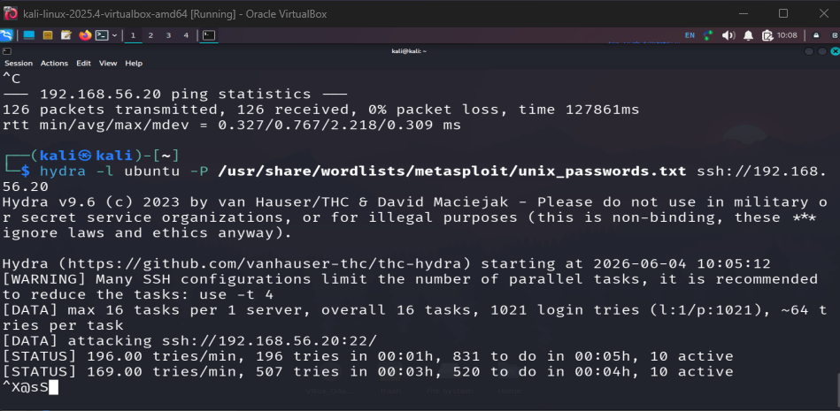
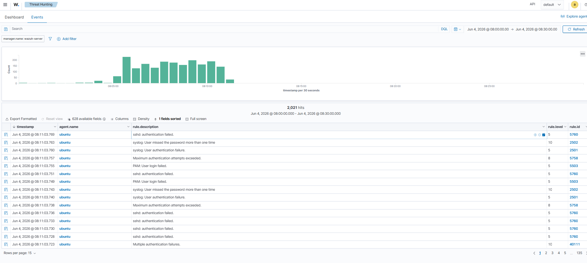

# Lab 08 — Brute Force Detection & Response

**Status:** 🔄 In Progress | **Difficulty:** Intermediate

---

## Overview

Simulate a real SSH and SMB brute force attack against HomeLab Corp, detect it with Wazuh SIEM, and harden the environment with fail2ban and account lockout policies. Covers the full detection engineering loop: generate attack → confirm detection → implement countermeasure → verify mitigation works.

**MITRE ATT&CK:** T1110.001 — Brute Force: Password Guessing

---

## Prerequisites

- [ ] Lab 07 complete (Wazuh agents active on DC01 and WEB01)
- [ ] KALI01 running with Hydra installed: `hydra -h`
- [ ] rockyou.txt wordlist available: `ls /usr/share/wordlists/rockyou.txt`

---

## Part 1 — SSH Brute Force Against WEB01

### 1.1 Execute the Attack (KALI01)

```bash
# Unzip wordlist if needed
sudo gunzip /usr/share/wordlists/rockyou.txt.gz

# Run SSH brute force
hydra -l raghav -P /usr/share/wordlists/rockyou.txt \
    192.168.56.101 ssh -t 4 -V -f
```

**Flag breakdown:**
- `-l raghav` — single username (real Linux user on WEB01)
- `-P rockyou.txt` — password wordlist
- `-t 4` — 4 parallel threads (gentle — avoids locking the account too fast)
- `-V` — verbose — show each attempt
- `-f` — stop on first success

Let Hydra run for **30–60 seconds** then `Ctrl+C`. The goal is failed logins for SIEM detection, not credential compromise.

### 1.2 Verify Detection in Wazuh

```
Dashboard → Security Events → Filter: agent.name: WEB01
```

Expected alerts:
- **Rule 5710** — `sshd: Attempt to login using a non-existent user` (Medium)
- **Rule 5720** — `sshd: Multiple authentication failures` (High — Level 10)

Also check the raw log directly on WEB01:
```bash
sudo tail -f /var/log/auth.log
# Look for: Failed password for raghav from 192.168.56.30 port XXXXX ssh2
```

### 1.3 Harden — Install fail2ban

```bash
# Install fail2ban
sudo apt install fail2ban -y

# Create local config
sudo cp /etc/fail2ban/jail.conf /etc/fail2ban/jail.local
sudo nano /etc/fail2ban/jail.local
```

Find the `[sshd]` section and set:
```ini
[sshd]
enabled  = true
maxretry = 5
bantime  = 3600
findtime = 600
```

```bash
# Enable and start
sudo systemctl enable fail2ban
sudo systemctl start fail2ban

# Verify
sudo fail2ban-client status sshd
```

### 1.4 Re-run Attack — Verify Mitigation

```bash
# From KALI01 — repeat the brute force
hydra -l raghav -P /usr/share/wordlists/rockyou.txt \
    192.168.56.101 ssh -t 4 -V -f
```

After 5 failures, KALI01's IP (192.168.56.30) should be banned. Hydra will show `Connection refused` instead of `Invalid login`.

```bash
# Confirm ban on WEB01
sudo fail2ban-client status sshd
# Output: Banned IP list: 192.168.56.30
```

---

## Part 2 — SMB Brute Force Against DC01

### 2.1 Execute the Attack (KALI01)

```bash
# SMB brute force against DC01
hydra -l administrator -P /usr/share/wordlists/rockyou.txt \
    192.168.56.10 smb -V

# Alternative with CrackMapExec (more realistic)
crackmapexec smb 192.168.56.10 -u administrator \
    -p /usr/share/wordlists/rockyou.txt
```

Run for 30–60 seconds then `Ctrl+C`.

### 2.2 Verify Detection

**In Wazuh:**
```
agent.name: DC01 AND rule.groups: "authentication_failed"
```

Expected alerts:
- **Rule 18116** — `Windows: Multiple authentication failures` (High)
- **Rule 18152** — `Windows: Brute force attack detected` (Critical)

**On DC01 — Windows Event Viewer:**
```
Start → Event Viewer → Windows Logs → Security → Filter Event ID 4625
```
You should see hundreds of Event ID 4625 entries from 192.168.56.30.

### 2.3 Harden — Account Lockout Policy (DC01)

```powershell
# Via Group Policy Management Console on DC01
# gpedit.msc → Computer Configuration → Windows Settings →
# Security Settings → Account Policies → Account Lockout Policy
#
# Set:
#   Account lockout threshold: 5 invalid logon attempts
#   Account lockout duration:  30 minutes
#   Reset account lockout counter after: 30 minutes
```

Or via PowerShell:
```powershell
# Requires Fine-Grained Password Policy or Default Domain Policy edit
# Simple approach — set via Default Domain Policy in GPMC
Import-Module ActiveDirectory
# Open: gpmc.msc → Default Domain Policy → Edit
```

### 2.4 Re-run Attack — Verify Lockout

After account lockout is configured, re-run Hydra. The `administrator` account should lock after 5 failures. Event ID **4740** (account locked out) will appear in Wazuh.

---

## Part 3 — UFW Rate Limiting (WEB01)

```bash
# Enable UFW and configure SSH rate limiting
sudo ufw enable
sudo ufw default deny incoming
sudo ufw allow 80/tcp
sudo ufw allow 443/tcp

# Allow SSH only from management IP (host machine), deny KALI01
sudo ufw allow from 192.168.56.1 to any port 22
sudo ufw deny from 192.168.56.30

sudo ufw status verbose
```

---

## Detection Summary

| Attack | Tool | SIEM Rule | Event |
|--------|------|-----------|-------|
| SSH brute force | Hydra | 5720 | /var/log/auth.log |
| SMB brute force | Hydra / CME | 18152 | Windows Event ID 4625 |
| Account lockout | (auto) | — | Windows Event ID 4740 |
| fail2ban ban | fail2ban | — | /var/log/fail2ban.log |

---

## Screenshots

### Attack Phase — Hydra SSH Brute Force

**Kali — Hydra SSH Brute Force Against WEB01 (192.168.56.20)**

> Hydra v9.6 running `-P /usr/share/wordlists/metasploit/unix_passwords.txt` against `ssh://192.168.56.20:22`. Shows 16 parallel tasks, 1021 login tries per run, firing at 196–507 tries/min. The burst traffic is exactly what triggers Wazuh Rule 5720.

### Detection Phase — Wazuh Threat Hunting

**Wazuh — Threat Hunting: 2,021 Authentication Failure Hits**

> Wazuh Threat Hunting → Events, filtered by `manager.name: wazuh-server`, time range Jun 4 08:00–08:30. Shows **2,021 alert hits** — `sshd: authentication failed` (Rule 5760), `Maximum authentication attempts exceeded` (Rule 2501), `PAM: User login failed` (Rule 5758). The histogram clearly shows the attack burst. Agent: ubuntu (WEB01). 135 pages of results.

---

## Key Learnings

- Hydra with `-t 4` threads is slow enough for learning but fast enough to trigger Wazuh thresholds. Use `-t 16` or higher in real pentesting.
- fail2ban monitors `/var/log/auth.log` and blocks IPs using iptables. The ban IP list is the primary evidence for SOC reporting.
- Windows Account Lockout Policy is the simplest and most impactful AD hardening control for credential attacks — every AD environment should have it configured.
- A brute force detection without a rate-limiting countermeasure in place is an incomplete finding — always show the full detection-to-remediation cycle.
